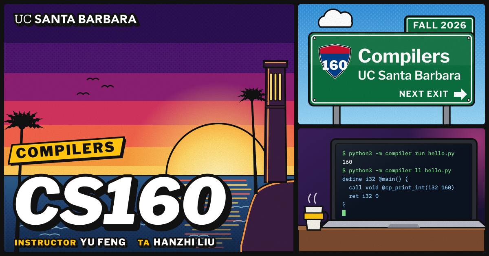

-----------------

[](https://github.com/trackoor/cs160-starter/actions/workflows/ci.yml)

This is the starter code for the compiler you build in [CS160 Compilers](https://github.com/fredfeng/CS160) at [UC Santa Barbara](https://www.cs.ucsb.edu). It translates the course's subset of [ChocoPy](https://chocopy.org) into LLVM IR. `clang` compiles that IR with the supplied C runtime to produce an executable.

Each of the six programming assignments adds to the same compiler. The assignment writeups are posted in the course repository under [`assignments/`](https://github.com/fredfeng/CS160/tree/main/assignments), and the language your compiler accepts is specified in [`chocopy/SPEC.md`](https://github.com/fredfeng/CS160/blob/main/chocopy/SPEC.md).

**Get your starter through OneWorld; do not fork this repository. Keep your solutions private.** Publishing or sharing solutions violates the [UCSB academic integrity policy](https://studentconduct.sa.ucsb.edu/academic-integrity).

## Getting the Starter Code

Each assignment's [OneWorld](https://oneworldai.com) page provides the commands to install the CLI, join the assignment and submit:

1. Run the installation command to install or update `oneworld` for each assignment.
2. Run `oneworld assessment join` with the assignment's invite code. It downloads the starter into a new folder and opens a shell there.
3. Work in that folder and run `oneworld assessment submit` there when ready. Submission includes your changes and the AI sessions you select.

From PA2 on, run `carry.py` in the new folder **before editing it** to bring over your previous assignment:

```console
$ python3 tools/carry.py ../previous-folder
```

Replace `../previous-folder` with your previous assignment's path; put paths containing spaces in quotes. The tool copies your Python modules directly in `compiler/`, your tests in `test/mine/` and your design documents, while keeping the new course-provided files. If it reports conflicting changes, it copies nothing; compare the listed files before choosing which version to keep.

After carrying PA2 into PA3, run `python3 tools/check.py pa1 pa2` to check your earlier work. `make check-tests` also includes the new PA3 tests; those are not expected to pass until you implement PA3.

Before submitting, run `oneworld assessment status` and check the assignment name. Select all relevant sessions if you submit sessions, and keep the receipt as confirmation of upload. Each handout describes the required code, tests and sessions or self-written design document. AI use is optional; no video or ZIP is required.

If you back up your work on GitHub, use a **private** repository.

## Build

You can develop your compiler on macOS, on Linux, or on Windows inside WSL 2. Grading runs on Linux.

### Linux / macOS

Install the required tools:

```console
# Linux
$ sudo build_support/packages.sh
# macOS
$ build_support/packages.sh
```

The script installs Python, clang and the `ruff` formatter and linter. Check your environment with:

```console
$ python3 tools/doctor.py
```

Your Python compiler needs no build step. Save a program as `prog.py`, then compile and run it with:

```console
$ python3 -m compiler run prog.py
```

These commands use the code you write: the initial lexer, parser and code generator raise `NotImplementedError`; the PA3 type checker initially accepts every program. In PA2, use `tokens` to test the lexer, `ast` to inspect the parser's tree and `make test-pa2` to run parser tests. While the parser is unfinished, `python3 -m compiler ast --parser=python prog.py` shows the reference tree, and `python3 tools/difftest.py --parser=python test/pa1` checks PA1.

Use `python3 -m compiler ll prog.py` to print LLVM IR, or `python3 -m compiler --help` for all commands. To run every released assignment's tests, including your tests in `test/mine`:

```console
$ make check-tests
```

For PA3 and PA4, use `--parser=python` with compiler commands and `difftest.py`, as the handouts do. Their `make test-pa3` and `make test-pa4` targets already select Python's parser, so a PA2 parser bug does not affect those assignments' tests. `make check-tests` also tests earlier assignments and can still report PA2 failures.

In PA3, test your type checker before implementing function code generation:

```console
$ python3 -m compiler check --parser=python prog.py
$ python3 tools/checktest.py --parser=python test/pa3
```

These commands run your checker without calling your code generator. The initial checker accepts every program, so rejection tests will fail until you implement it; the handout gives the tests to run after each exercise. Function code-generation failures in `difftest.py` are expected until Exercise 3 is complete. Send debug prints to standard error after `import sys`: `print(message, file=sys.stderr)`. Run `check` or `checktest.py` directly to see them; `make test-pa3` summarizes results and `difftest.py` captures compiler output.

For code-generation tests, use `--verify` to check the generated IR, for example `python3 tools/difftest.py --parser=python --verify test/pa1`. If a result differs from grading, try it on Linux; compiler behavior can differ between platforms.
